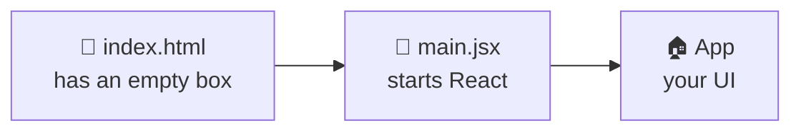

# 🚦 How React Starts

*`index.html` → `main.jsx` → `App`*



## 1️⃣ `index.html` → an empty box 📦

```html
<body>
  <div id="root"></div>                              <!-- 📦 empty box -->
  <script type="module" src="/src/main.jsx"></script> <!-- ▶️ run main.jsx -->
</body>
```

- `<div id="root">` → an **empty box**. Your whole app will go inside it.
- `<script>` → tells the browser to **run `main.jsx`**.

## 2️⃣ `main.jsx` → puts the app in the box 🚀

```jsx
import { createRoot } from "react-dom/client"; // 🧰 tool to start React
import App from "./App.jsx";                    // 🏠 your main component

createRoot(document.getElementById("root"))    // 📦 find the empty box
  .render(<App />);                             // 🎨 draw App inside it
```

- `createRoot(...)` → "React, **take control** of this box."
- `.render(<App />)` → "Now **draw** the App inside it."

## 3️⃣ `App` → what you see on screen 🖥️

> 💡 The page starts **empty**. React fills the `#root` box with your app.

> 🖼️ Like a **photo frame**: `index.html` is the empty frame, `App` is the photo, and `main.jsx` puts the photo in the frame.

---
[← Setup with Vite](../level-01-react-basics/05-setup-with-vite.md) | [Level 1 index](README.md) | [All levels](../README.md) | [JSX →](../level-01-react-basics/07-jsx.md)
