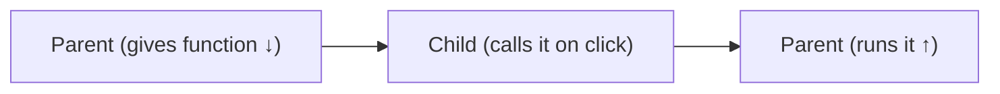

# Passing Functions as Props

*How a child talks back to the parent*

```jsx
function Parent() {
  function handleLike(name) {
    console.log(name + " liked!");
  }
  return <Child onLike={handleLike} />;
}
```

```jsx
function Child({ onLike }) {
  return (
    <button onClick={() => onLike("Aman")}>
      Like
    </button>
  );
}
```



---
[← children Prop](../level-02-props/05-children-prop.md) | [Level 2 index](README.md) | [All levels](../README.md) | [Prop Drilling →](../level-02-props/07-prop-drilling.md)
