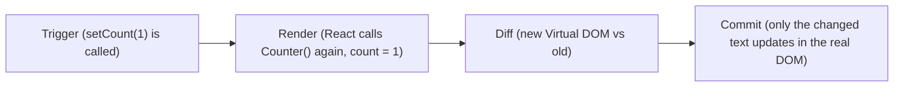

# What Happens on setState?

*The render cycle*

- Each render is a **snapshot** - the function runs again top to bottom with the new state
- Re-rendering a component also re-renders **its children**

---
[← useState](../level-03-state-events/02-usestate.md) | [Level 3 index](README.md) | [All levels](../README.md) | [State is a Snapshot →](../level-03-state-events/04-state-is-a-snapshot.md)
