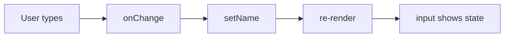

# Controlled Inputs

*React state is the single source of truth*

```jsx
function NameInput() {
  const [name, setName] = useState("");
  return (
    <>
      <input value={name} onChange={(e) => setName(e.target.value)} />
      <p>Hello, {name}</p>
    </>
  );
}
```



> **Careful :** value without onChange = a read-only input (React warns you).

---
[← Filter & Search a List](../level-04-lists-forms/03-filter-search-a-list.md) | [Level 4 index](README.md) | [All levels](../README.md) | [Forms with Many Inputs →](../level-04-lists-forms/05-forms-with-many-inputs.md)
