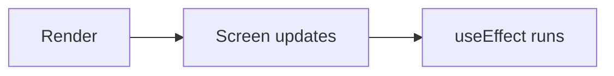

# useEffect

```jsx
import { useEffect, useState } from "react";

function Title() {
  const [count, setCount] = useState(0);

  useEffect(() => {
    document.title = `Clicked ${count} times`;   // side effect
  }, [count]);                                   // dependency array

  return <button onClick={() => setCount(count + 1)}>Click</button>;
}
```



---
[← Side Effects](../level-05-useeffect/01-side-effects.md) | [Level 5 index](README.md) | [All levels](../README.md) | [The Dependency Array →](../level-05-useeffect/03-the-dependency-array.md)
