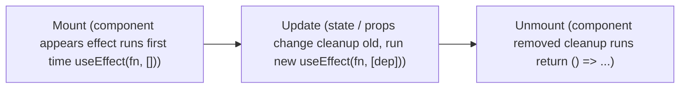

# Component Lifecycle

*useEffect covers all 3 phases*

> **Old way :** In class components these were componentDidMount, componentDidUpdate & componentWillUnmount.

---
[← Cleanup Function](../level-05-useeffect/04-cleanup-function.md) | [Level 5 index](README.md) | [All levels](../README.md) | [Fetching Data →](../level-05-useeffect/06-fetching-data.md)
