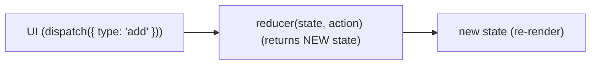

# useReducer

*For complex state with many actions*



```jsx
function reducer(state, action) {
  switch (action.type) {
    case "increment": return { count: state.count + 1 };
    case "decrement": return { count: state.count - 1 };
    case "reset":     return { count: 0 };
    default:          return state;
  }
}
const [state, dispatch] = useReducer(reducer, { count: 0 });
<button onClick={() => dispatch({ type: "increment" })}>+</button>
```

---
[← useRef for Values](../level-06-useref-usereducer/03-useref-for-values.md) | [Level 6 index](README.md) | [All levels](../README.md) | [useReducer : Todo Example →](../level-06-useref-usereducer/05-usereducer-todo-example.md)
