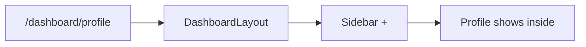

# Nested Routes & Outlet

*Shared layout for many pages*

```jsx
<Route path="/dashboard" element={<DashboardLayout />}>
  <Route index element={<Overview />} />
  <Route path="profile" element={<Profile />} />
  <Route path="settings" element={<Settings />} />
</Route>
```

```jsx
function DashboardLayout() {
  return (
    <div className="layout">
      <Sidebar />
      <main>
        <Outlet />   {/* child page here */}
      </main>
    </div>
  );
}
```



---
[← useNavigate](../level-09-react-router/04-usenavigate.md) | [Level 9 index](README.md) | [All levels](../README.md) | [Protected Routes →](../level-09-react-router/06-protected-routes.md)
