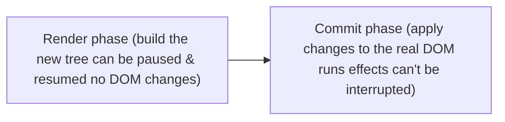

# React Fiber

*The engine behind reconciliation (React 16+)*

- Work is split into small units (fibers), so React can pause for urgent updates like typing
- Enables **concurrent features** : useTransition, Suspense, automatic batching

---
[← Reconciliation](../level-11-under-the-hood-advanced/01-reconciliation.md) | [Level 11 index](README.md) | [All levels](../README.md) | [Lifecycle in Class Components →](../level-11-under-the-hood-advanced/03-lifecycle-in-class-components.md)
