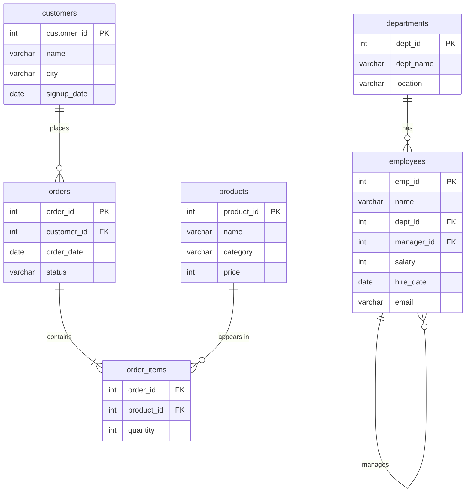

# 00 · Sample Database (run this first)

Every example and practice problem in these notes uses this small **company + shop** database.
Run the script once, then try every query yourself.

> **Where to run it :** MySQL Workbench, [DB Fiddle](https://www.db-fiddle.com/), [SQLite Online](https://sqliteonline.com/), or VS Code with the *SQLite* extension.
> The script uses standard SQL that works in MySQL 8, PostgreSQL and SQLite.

## The tables



## Setup script

```sql
CREATE TABLE departments (
    dept_id    INT PRIMARY KEY,
    dept_name  VARCHAR(50) NOT NULL,
    location   VARCHAR(50)
);

CREATE TABLE employees (
    emp_id     INT PRIMARY KEY,
    name       VARCHAR(50) NOT NULL,
    dept_id    INT,
    manager_id INT,
    salary     INT CHECK (salary > 0),
    hire_date  DATE,
    email      VARCHAR(100),
    FOREIGN KEY (dept_id)    REFERENCES departments(dept_id),
    FOREIGN KEY (manager_id) REFERENCES employees(emp_id)
);

CREATE TABLE customers (
    customer_id INT PRIMARY KEY,
    name        VARCHAR(50) NOT NULL,
    city        VARCHAR(50),
    signup_date DATE
);

CREATE TABLE products (
    product_id INT PRIMARY KEY,
    name       VARCHAR(50) NOT NULL,
    category   VARCHAR(30),
    price      INT
);

CREATE TABLE orders (
    order_id    INT PRIMARY KEY,
    customer_id INT,
    order_date  DATE,
    status      VARCHAR(20),
    FOREIGN KEY (customer_id) REFERENCES customers(customer_id)
);

CREATE TABLE order_items (
    order_id   INT,
    product_id INT,
    quantity   INT,
    PRIMARY KEY (order_id, product_id),
    FOREIGN KEY (order_id)   REFERENCES orders(order_id),
    FOREIGN KEY (product_id) REFERENCES products(product_id)
);

INSERT INTO departments VALUES
 (1, 'Engineering', 'Bangalore'),
 (2, 'Marketing',   'Mumbai'),
 (3, 'Sales',       'Delhi'),
 (4, 'HR',          'Agra');            -- HR has no employees (useful for LEFT JOIN)

INSERT INTO employees VALUES
 (1,  'Aman',   1, NULL, 150000, '2019-04-10', 'aman@company.com'),
 (2,  'Neha',   1, 1,    120000, '2020-06-15', 'neha@company.com'),
 (3,  'Rahul',  1, 1,    120000, '2021-01-20', 'rahul@company.com'),
 (4,  'Priya',  1, 2,     90000, '2022-03-05', 'priya@company.com'),
 (5,  'Vikram', 2, NULL, 110000, '2018-11-01', 'vikram@company.com'),
 (6,  'Sneha',  2, 5,     70000, '2023-02-14', NULL),
 (7,  'Arjun',  3, NULL,  95000, '2019-08-23', 'arjun@company.com'),
 (8,  'Kavya',  3, 7,     60000, '2024-01-08', 'kavya@company.com'),
 (9,  'Rohit',  3, 7,     60000, '2024-05-19', 'rohit@company.com'),
 (10, 'Meera',  NULL, NULL, 50000, '2025-07-01', 'meera@company.com');   -- no department

INSERT INTO customers VALUES
 (1, 'Ankit',  'Agra',      '2024-01-05'),
 (2, 'Simran', 'Delhi',     '2024-02-11'),
 (3, 'Karan',  'Mumbai',    '2024-03-20'),
 (4, 'Pooja',  'Agra',      '2024-04-02'),
 (5, 'Dev',    'Bangalore', '2024-06-30');   -- never ordered

INSERT INTO products VALUES
 (1, 'Laptop',     'Electronics', 60000),
 (2, 'Phone',      'Electronics', 25000),
 (3, 'Headphones', 'Electronics',  3000),
 (4, 'T-Shirt',    'Clothing',      800),
 (5, 'Jeans',      'Clothing',     2000),
 (6, 'Novel',      'Books',         400);   -- never sold

INSERT INTO orders VALUES
 (101, 1, '2024-07-01', 'delivered'),
 (102, 2, '2024-07-03', 'delivered'),
 (103, 1, '2024-07-15', 'cancelled'),
 (104, 3, '2024-08-02', 'delivered'),
 (105, 4, '2024-08-20', 'pending'),
 (106, 2, '2024-09-05', 'delivered'),
 (107, 1, '2024-09-18', 'delivered');

INSERT INTO order_items VALUES
 (101, 1, 1), (101, 3, 2),
 (102, 2, 1),
 (103, 4, 3),
 (104, 5, 2), (104, 4, 1),
 (105, 3, 1),
 (106, 1, 1), (106, 2, 1),
 (107, 4, 5);
```

## Quick look at the main table

`employees`

| emp_id | name | dept_id | manager_id | salary | hire_date | email |
|---|---|---|---|---|---|---|
| 1 | Aman | 1 | NULL | 150000 | 2019-04-10 | aman@company.com |
| 2 | Neha | 1 | 1 | 120000 | 2020-06-15 | neha@company.com |
| 3 | Rahul | 1 | 1 | 120000 | 2021-01-20 | rahul@company.com |
| 4 | Priya | 1 | 2 | 90000 | 2022-03-05 | priya@company.com |
| 5 | Vikram | 2 | NULL | 110000 | 2018-11-01 | vikram@company.com |
| 6 | Sneha | 2 | 5 | 70000 | 2023-02-14 | NULL |
| 7 | Arjun | 3 | NULL | 95000 | 2019-08-23 | arjun@company.com |
| 8 | Kavya | 3 | 7 | 60000 | 2024-01-08 | kavya@company.com |
| 9 | Rohit | 3 | 7 | 60000 | 2024-05-19 | rohit@company.com |
| 10 | Meera | NULL | NULL | 50000 | 2025-07-01 | meera@company.com |

> **Tricky rows on purpose :** HR has no employees, Meera has no department, Sneha has no email,
> Dev never ordered, Novel was never sold, and two people share the same salary (120000 and 60000).
> These are exactly the cases interviewers test.

---
[Next : 01 · Databases & SQL Basics →](01-databases-and-sql-basics.md) · [Index](README.md)
