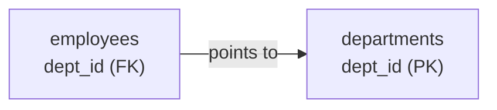

# 01 · Databases & SQL Basics

> Before writing queries, know **what** you are talking to.

## What is a database?

A **database** is an organised collection of data. A **DBMS** (Database Management System) is the software that stores it, keeps it safe and lets you query it - MySQL, PostgreSQL, SQLite, Oracle, SQL Server.

A **relational database (RDBMS)** stores data in **tables** that are linked to each other.

```
                    employees  (a TABLE / relation)
            ┌────────┬────────┬─────────┬────────┐
  columns → │ emp_id │ name   │ dept_id │ salary │   ← column = attribute / field
            ├────────┼────────┼─────────┼────────┤
            │ 1      │ Aman   │ 1       │ 150000 │   ← row = record / tuple
            │ 2      │ Neha   │ 1       │ 120000 │
            └────────┴────────┴─────────┴────────┘
```

> **Example :** A table is like an Excel sheet with strict rules - every column has a fixed type, and every row must follow them.

## What is SQL?

**SQL (Structured Query Language)** is the language used to talk to relational databases. It is **declarative** - you say *what* you want, the database decides *how* to get it.

```sql
SELECT name, salary FROM employees WHERE salary > 100000;
-- "give me names & salaries of people earning more than 1 lakh"
```

## SQL sub-languages

| Group | Full form | Commands | Used to |
|---|---|---|---|
| **DDL** | Data Definition Language | `CREATE`, `ALTER`, `DROP`, `TRUNCATE`, `RENAME` | define the structure |
| **DML** | Data Manipulation Language | `INSERT`, `UPDATE`, `DELETE` | change the data |
| **DQL** | Data Query Language | `SELECT` | read the data |
| **DCL** | Data Control Language | `GRANT`, `REVOKE` | permissions |
| **TCL** | Transaction Control Language | `COMMIT`, `ROLLBACK`, `SAVEPOINT` | manage transactions |

## Keys - how rows are identified & linked

| Key | Meaning | In our database |
|---|---|---|
| **Primary key** | uniquely identifies each row, never NULL | `employees.emp_id` |
| **Foreign key** | column that points to a primary key in another (or same) table | `employees.dept_id → departments.dept_id` |
| **Candidate key** | any column set that *could* be the primary key | `emp_id`, `email` |
| **Composite key** | primary key made of 2+ columns | `order_items(order_id, product_id)` |
| **Unique key** | values must be unique, but NULL allowed | `email` |
| **Super key** | any set of columns that uniquely identifies a row | `(emp_id, name)` |



## Relationships

```
One-to-One     user ── profile            (1 user has 1 profile)
One-to-Many    department ──< employees   (1 dept has many employees)   ← most common
Many-to-Many   orders >──< products       (needs a junction table: order_items)
```

## SQL vs NoSQL

| | SQL (relational) | NoSQL |
|---|---|---|
| Structure | fixed tables & schema | flexible documents, key-value, graphs |
| Examples | MySQL, PostgreSQL | MongoDB, Redis, Cassandra |
| Joins | strong support | limited / avoided |
| Transactions | full ACID | varies (often eventual consistency) |
| Best for | banking, orders, structured data | huge scale, changing structure, caching |

## Theory Questions

<details><summary><b>Q1. DBMS vs RDBMS?</b></summary>

DBMS stores data in any form (files, hierarchies). RDBMS stores data in related tables with keys, supports SQL, constraints and ACID transactions.
</details>

<details><summary><b>Q2. Primary key vs unique key?</b></summary>

Both are unique. A primary key can't be NULL and a table has only one. A unique key allows NULL (one or more, depending on the DB) and a table can have many.
</details>

<details><summary><b>Q3. What is a foreign key?</b></summary>

A column that refers to the primary key of another table. It enforces **referential integrity** - you can't add an employee to a department that doesn't exist.
</details>

<details><summary><b>Q4. How do you model a many-to-many relationship?</b></summary>

With a junction (bridge) table holding both foreign keys - like `order_items(order_id, product_id)`.
</details>

<details><summary><b>Q5. Is SQL case-sensitive?</b></summary>

Keywords are not (`select` = `SELECT`). Data comparison depends on the database & collation (MySQL is case-insensitive by default, PostgreSQL is case-sensitive).
</details>

## Practice (on paper)

1. Name the primary key and foreign keys of every table in the [sample database](00-sample-database.md).
2. Which relationship is `customers → orders`? And `orders ↔ products`?
3. Classify each : `SELECT`, `TRUNCATE`, `GRANT`, `UPDATE`, `ROLLBACK`.

<details><summary>Answers</summary>

1. `departments(dept_id)`, `employees(emp_id; FK dept_id, manager_id)`, `customers(customer_id)`, `products(product_id)`, `orders(order_id; FK customer_id)`, `order_items((order_id, product_id); FK both)`
2. One-to-many. Many-to-many through `order_items`.
3. DQL, DDL, DCL, DML, TCL.
</details>

---
[← 00 · Sample Database](00-sample-database.md) · [Index](README.md) · [02 · Create Tables & Constraints →](02-create-tables-and-constraints.md)
