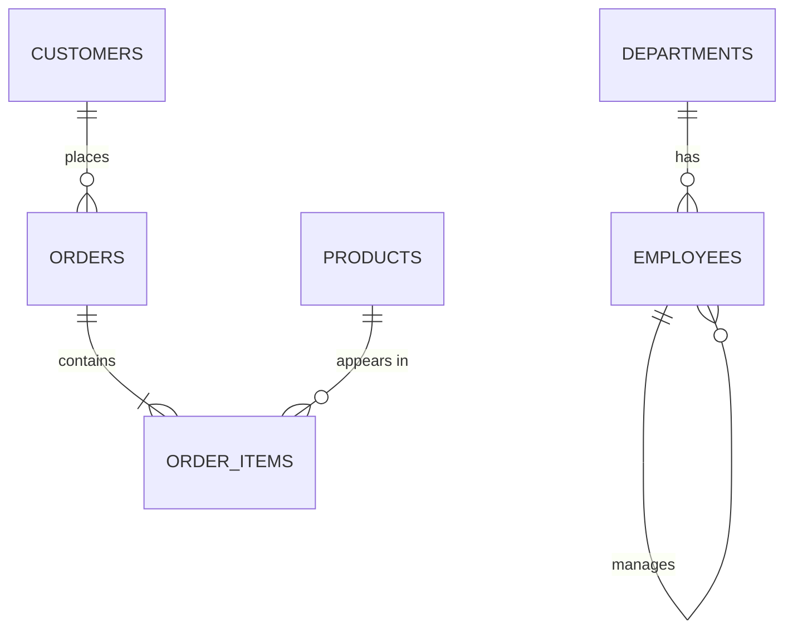

# 11 · Keys, ER Model & Normalization

> How to design tables so data is stored once, correctly, and never contradicts itself.

## Keys : who is who

| Key | Meaning | Example (our DB) |
|---|---|---|
| **Super key** | any set of columns that uniquely identifies a row | `{emp_id}`, `{emp_id, name}` |
| **Candidate key** | a *minimal* super key (no extra column) | `emp_id`, `email` |
| **Primary key** | the candidate key you choose; unique + NOT NULL | `emp_id` |
| **Alternate key** | candidate keys not chosen as PK | `email` |
| **Foreign key** | column pointing to a PK in another table | `employees.dept_id → departments.dept_id` |
| **Composite key** | PK made of 2+ columns | `order_items(order_id, product_id)` |
| **Surrogate key** | artificial id with no business meaning | auto-increment `id` |
| **Natural key** | real-world unique value | Aadhaar no., email |

```
Super keys  ⊇  Candidate keys  ⊇  Primary key
 (big bag)      (minimal ones)     (the chosen one)
```

## ER model & relationships



| Relationship | Example | How to build |
|---|---|---|
| **1 : 1** | person ↔ passport | FK + UNIQUE on one side |
| **1 : N** | department → employees | FK on the "many" side |
| **M : N** | orders ↔ products | junction table (`order_items`) |
| **Self** | employee → manager | FK to the same table |

## Why normalize? Anomalies

Imagine one big "everything" table:

```
┌──────────┬───────┬──────────────┬──────────┬─────────────┐
│ order_id │ cust  │ cust_city    │ product  │ price       │
├──────────┼───────┼──────────────┼──────────┼─────────────┤
│ 101      │ Ankit │ Agra         │ Laptop   │ 60000       │
│ 101      │ Ankit │ Agra         │ Headph.  │ 3000        │
│ 107      │ Ankit │ Agar  ◄── typo, now Ankit lives in 2 cities!
└──────────┴───────┴──────────────┴──────────┴─────────────┘
```

| Anomaly | What goes wrong |
|---|---|
| **Update** | change Ankit's city in one row, forget others → contradiction |
| **Insert** | can't add a new product until someone orders it |
| **Delete** | delete the only order of Novel → product info lost too |

Normalization = splitting this into smaller tables linked by keys.

## Functional dependency (FD)

`A → B` means "if I know A, I know B". `emp_id → name, salary`. `dept_id → dept_name`.

## The normal forms (step by step)

```
UNF ──► 1NF ──► 2NF ──► 3NF ──► BCNF
   atomic   no partial   no transitive   every determinant
   values   dependency   dependency      is a candidate key
```

### 1NF : atomic values, no repeating groups

```
✗  emp | phones                     ✓  emp | phone
   Aman| 98xx, 97xx                    Aman| 98xx
                                       Aman| 97xx
```

### 2NF : 1NF + no partial dependency
(only matters with a composite key - non-key columns must depend on the **whole** key)

```
order_items(order_id, product_id, quantity, product_name)
                          └─────────────────────▲
product_name depends only on product_id (part of key) ✗
→ move product_name to products(product_id, product_name)
```

### 3NF : 2NF + no transitive dependency
(non-key → non-key is not allowed)

```
employees(emp_id, dept_id, dept_name)
emp_id → dept_id → dept_name   ✗ transitive
→ move dept_name into departments(dept_id, dept_name)
```

Easy line to remember: *"Every non-key column depends on the key, the whole key, and nothing but the key."*

### BCNF : stricter 3NF
For every FD `X → Y`, X must be a super key.
Example: (student, course) → teacher, but teacher → course. teacher is not a key → violates BCNF → split into (teacher, course) and (student, teacher).

## Denormalization

Deliberately adding redundancy (e.g., storing `total_amount` in `orders`) to make reads faster and avoid heavy joins. Common in analytics / reporting. Price: harder writes and a risk of inconsistency.

| Normalized | Denormalized |
|---|---|
| less redundancy, safe writes | faster reads, fewer joins |
| OLTP apps (banking, orders) | OLAP / dashboards / data warehouses |

## Theory Questions

<details><summary><b>Q1. Primary key vs Unique key?</b></summary>

PK: one per table, cannot be NULL, usually clustered index. UNIQUE: many allowed per table, allows NULL (MySQL allows multiple NULLs).
</details>

<details><summary><b>Q2. Candidate key vs Super key?</b></summary>

A super key is any column set that uniquely identifies rows. A candidate key is a minimal super key - remove any column and it stops being unique.
</details>

<details><summary><b>Q3. What is normalization and why?</b></summary>

Organizing tables to remove redundancy and avoid update/insert/delete anomalies, by splitting tables based on functional dependencies.
</details>

<details><summary><b>Q4. Explain 1NF, 2NF, 3NF in one line each.</b></summary>

1NF: atomic values. 2NF: no non-key column depends on part of a composite key. 3NF: no non-key column depends on another non-key column.
</details>

<details><summary><b>Q5. 3NF vs BCNF?</b></summary>

3NF allows `X → Y` where Y is a prime (key) attribute even if X is not a super key. BCNF does not: every determinant must be a super key.
</details>

<details><summary><b>Q6. How do you model a many-to-many relationship?</b></summary>

A junction (bridge) table with two FKs, usually forming a composite PK - like `order_items(order_id, product_id)`.
</details>

<details><summary><b>Q7. When would you denormalize?</b></summary>

When reads dominate and joins are slow - reporting, caching counts, data warehouses (star schema).
</details>

## Practice Problems

**P1.** Find candidate keys: `order_items(order_id, product_id, quantity)`.

<details><summary>Solution</summary>

Only `(order_id, product_id)` - neither column alone is unique.
</details>

**P2.** Normalize: `student(roll, name, course_id, course_name, teacher)` where a student takes many courses.

<details><summary>Solution</summary>

```
students(roll PK, name)
courses(course_id PK, course_name, teacher)
enrollments(roll FK, course_id FK, PRIMARY KEY(roll, course_id))
```
</details>

**P3.** Our `employees` table has `dept_id` but not `dept_name`. Which normal form violation does that avoid? Show the join that gets the name back.

<details><summary>Solution</summary>

Avoids a transitive dependency (3NF): `emp_id → dept_id → dept_name`.

```sql
SELECT e.name, d.dept_name
FROM employees e LEFT JOIN departments d ON e.dept_id = d.dept_id;
```
</details>

**P4.** Check the "data contract": prove `email` is a candidate key (no duplicates among non-NULL values).

<details><summary>Solution</summary>

```sql
SELECT email, COUNT(*) FROM employees
WHERE email IS NOT NULL
GROUP BY email HAVING COUNT(*) > 1;   -- empty result = unique
```
</details>

## LeetCode Problems

LeetCode doesn't test design directly, but these problems feel easy only if you understand keys and relationships:

| # | Problem | Level | Concept |
|---|---|---|---|
| 196 | [Delete Duplicate Emails](https://leetcode.com/problems/delete-duplicate-emails/) | Easy | enforcing uniqueness |
| 182 | [Duplicate Emails](https://leetcode.com/problems/duplicate-emails/) | Easy | candidate-key check |
| 1965 | [Employees With Missing Information](https://leetcode.com/problems/employees-with-missing-information/) | Easy | 1:1 tables split apart |
| 1050 | [Actors and Directors Who Cooperated At Least Three Times](https://leetcode.com/problems/actors-and-directors-who-cooperated-at-least-three-times/) | Easy | composite key grouping |
| 1795 | [Rearrange Products Table](https://leetcode.com/problems/rearrange-products-table/) | Easy | wide → normalized (unpivot) |

---
[← 10 · Window Functions](10-window-functions.md) · [Index](README.md) · [12 · Indexes, Views & Transactions →](12-indexes-views-transactions.md)
